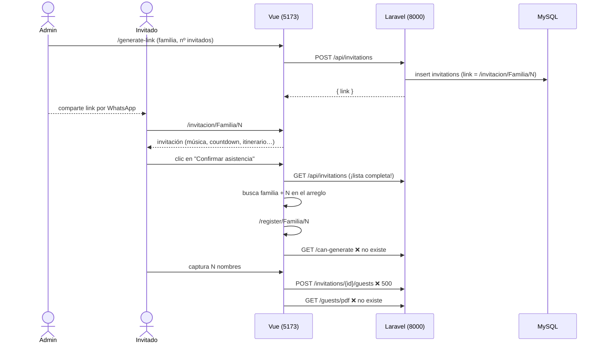

# Arquitectura actual — repo `rjm019/invitaciones`

- **Commit analizado:** `59d723f` ("subir proyecto inicial", 5-ago-2025).
- **Visibilidad:** público (se clona sin credenciales).

```
invitaciones/
├── README.md                 ← solo el título
├── api-invitation/           ← Backend: Laravel 11 + Sanctum + Breeze (API), MySQL
└── boda-invitacion/          ← Frontend: Vue 3 + Vite + vue-router + axios (+ Font Awesome, lodash)
```

## 1. Backend — `api-invitation`

| Pieza | Detalle |
|---|---|
| Framework | Laravel `^11.31`, PHP `^8.2`, Sanctum `^4.0`, Breeze `^2.2` (rutas de auth API en `routes/auth.php`) |
| Base de datos | MySQL (`DB_DATABASE=api_invitation`) |
| Modelos | `Invitation` (`family_name`, `max_guests`, `link`), que tiene muchos `Guest` (`invitation_id`, `first_name`, `last_name`) |
| Migraciones | `create_invitations_table`, `create_guests_table` (FK con `cascade`), más las de Laravel y Sanctum |
| Controladores | `InvitationController` (`index`, `store`, `show`) y `GuestController` (`index` ×2 ⚠️, `store`) |
| CORS | Orígenes `localhost:5173` y `localhost:3000`, `supports_credentials: true` |
| Tests | Solo los que trae Breeze (auth); ninguno del dominio de invitaciones |

### Endpoints (`routes/api.php`)

| Método | Ruta | Acción | Estado |
|---|---|---|---|
| GET | `/api/invitations` | `InvitationController@index` | Devuelve **todas** las invitaciones, sin auth |
| POST | `/api/invitations` | `InvitationController@store` | Crea la invitación y arma el link `http://localhost:5173/invitacion/{familia}/{pases}` |
| GET | `/api/invitations/{id}` | `InvitationController@show` | Invitación con sus invitados |
| POST | `/api/invitations/{id}/guests` | `GuestController@store` | ❌ Error 500 por el `index()` duplicado |
| GET | `/api/invitations/{id}/guests` | `GuestController@index` | ❌ Error 500 por el mismo motivo |
| GET | `/api/guests` | `GuestController@listAll` | ❌ El método no existe |
| — | `/api/invitations/{id}/can-generate` | — | ❌ Lo usa el frontend y no existe |
| — | `/api/invitations/{id}/guests/pdf` | — | ❌ Lo usa el frontend y no existe |

## 2. Frontend — `boda-invitacion`

| Pieza | Detalle |
|---|---|
| Stack | Vue `^3.5`, Vite `^6`, vue-router `^4.4`, axios, lodash/throttle, `@fortawesome/fontawesome-free` |
| TypeScript | El proyecto está configurado con TS (`vue-tsc`), pero los componentes usan **Options API en JS** |
| Rutas | `/generate-link` → `GenerateLink.vue`; `/invitacion/:familyName/:maxGuests` → `Invitation.vue` ⚠️ (el archivo real es `invitation.vue`); `/register/:familyName/:maxGuests` → `RegisterGuests.vue` |
| Componentes propios | `invitation.vue` (1293 líneas: plantilla, lógica y estilos de la boda), `GenerateLink.vue` (admin sin login), `RegisterGuests.vue` (registro de asistentes) |
| Sobrantes del scaffold | `TheWelcome.vue`, `icons/*`, `views/HomeView.vue`, `views/AboutView.vue`, `assets/base.css` |
| Assets | `public/`: fotos de la boda, `cj.png` y `vj.png` (iniciales), **`audio.mp3` de 9.4 MB** |

## 3. Flujo actual (como fue diseñado)



## 4. Lo que está bien planteado (se conserva)

- **Separación API / SPA:** permite hospedar el frontend estático (Netlify o Vercel) y la API en un VPS.
- **Modelo familia → invitados con límite de pases:** es exactamente lo que Canva no puede hacer.
- **Validación base en `GuestController@store`** (`guests` como arreglo con `max:` pases).
- **Efectos de la invitación:** audio, countdown, timeline con scroll, tarjetas de ubicación y hoteles. Ver `efectos-reutilizables.md`.
- **Breeze y Sanctum ya instalados:** sirven para el panel de administración con login.

## 5. Lo que hay que cambiar de raíz

1. **Identificar invitaciones por un token aleatorio**, no por familia y número en la URL.
2. **Separar datos y presentación:** hoy la boda está fija dentro de `invitation.vue`. Pasa a configuración por evento más **temas**.
3. **Proteger con auth:** generar links, listar familias y ver respuestas requiere login (Sanctum).
4. **Guardar el RSVP como estado** (confirmado o no asiste), con fecha de respuesta y reemplazo idempotente.
5. **Configurar por entorno:** URLs de la API y del frontend en `.env` y `VITE_API_URL`.
