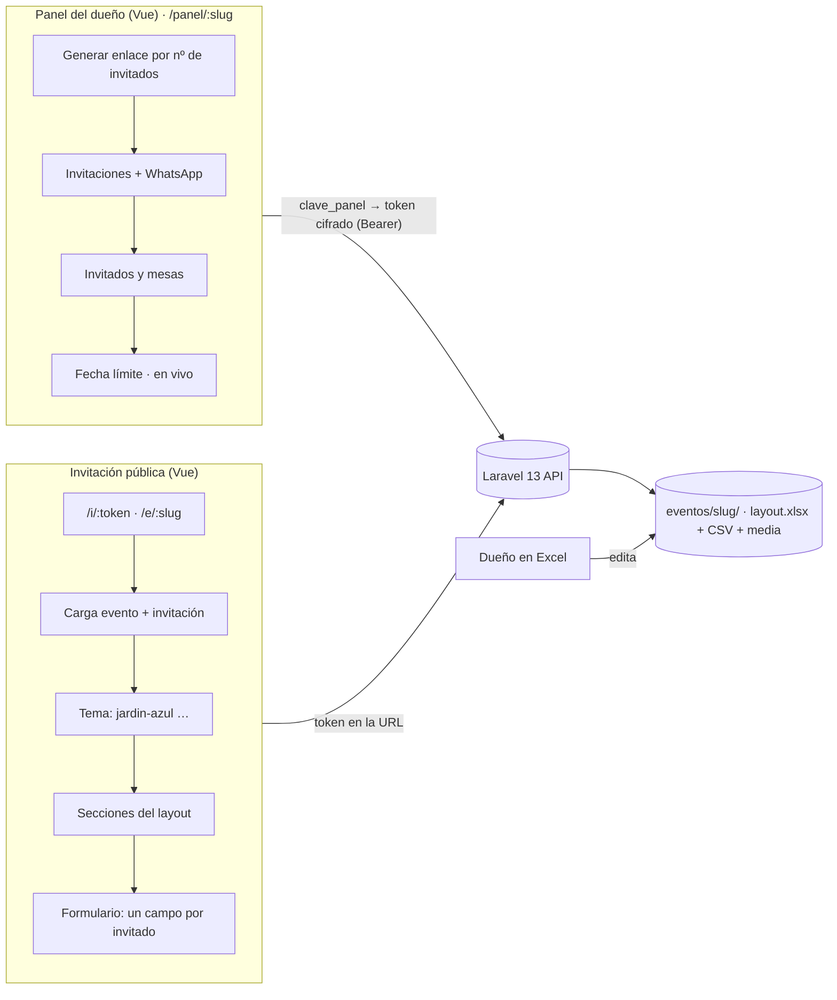

# Arquitectura objetivo — "motor de invitaciones" reutilizable

**Objetivo:** que una invitación nueva = **un layout de evento (Excel) + un tema + assets**, sin tocar código. Los temas se escriben una vez y se reutilizan.

> **Actualizado el 13-oct-2026** con lo que se construyó: sin base de datos, con el panel por evento y en Docker. Lo que cambió contra el plan original y por qué está en `../09-avance.md`.



## 1. Decisiones de arquitectura

| Decisión | Elección | Motivo |
|---|---|---|
| Repo | **Monorepo** `api/` + `web/` + `recepcion/` (el buscador) + `docs/` | Todo en un lugar; las tres apps no dependen entre sí en tiempo de ejecución |
| Entorno | Todo en Docker (`docker compose up`) | No instalar PHP ni Node en la máquina |
| Backend | Laravel 13, PHP 8.3, **sin base de datos** | El estado vive en archivos que se abren en Excel, como el buscador |
| Frontend | Vue 3 + Vite + TypeScript con `<script setup>`; la lógica en `services/` (TS puro, con pruebas) | Probar sin DOM; los componentes solo pintan |
| Estado | Composables + `provide/inject` del evento; sin Pinia | Simplicidad |
| Estilos | CSS por tema con **variables CSS** + CSS scoped por sección; tamaños en `cqi` contra el contenedor de la sección | Los temas cambian tokens, no componentes |
| Contenido del evento | `eventos/<slug>/layout.xlsx` (o un CSV por pestaña) → `EventConfigBuilder` → `config` | El dueño edita en Excel; los errores salen en español |
| Datos que escribe la API | CSV por evento (`invitaciones`, `respuestas`, `aperturas`, `ajustes`) con `flock`, escritura atómica, respaldo del día e historial | Seguro sin base de datos (ver `modelo-datos.md`) |
| Acceso al panel | `clave_panel` en el Excel → token cifrado con `APP_KEY` (12 h) | Un dueño por evento, sin usuarios |
| Identificación del invitado | Token aleatorio de 12 caracteres (base62), único | No adivinable y corto para WhatsApp |
| Panel en vivo | `GET …/version` (huella de los archivos) cada 5 s; recarga solo si cambió | En vivo sin websockets ni base de datos |
| Archivos | `eventos/<slug>/media/`, servidos por `GET /media/{slug}/{archivo}` | Fuera de git; viajan con el evento |
| PDF y QR | `barryvdh/laravel-dompdf` + `simplesoftwareio/simple-qrcode` | Pases con QR para la entrada (pendiente) |
| Rutas públicas | `/i/:token` (personal, con su formulario) y `/e/:slug` (general, sin pases) | Dos modos de uso |
| SEO | `noindex, nofollow`; Open Graph por evento (pendiente, fase 7) | Privacidad + vista previa en WhatsApp |
| Diseño | Celular primero; en ≥ 1024 px, las secciones `mitad` van en pares | También se ve bien en computadora |
| Música | MP3 del evento **o** playlist de Spotify (`musica_fuente`), con la API oficial del reproductor de Spotify | Con Spotify, la playlist suena al abrir el sobre |
| Clima | Open-Meteo desde la API, con caché (30 min el pronóstico, 30 días el típico) | Sin llave; los invitados no llaman a Open-Meteo directamente |

## 2. Estructura de carpetas

```
api/
├── app/
│   ├── Console/Commands/      InvitationSummary (invitaciones:resumen) · BuildLayoutXlsx (layout:xlsx) · OptimizeMedia (media:optimizar)
│   ├── Http/
│   │   ├── Controllers/Public/   EventController · InvitationController · RsvpController · WeatherController · MediaController
│   │   ├── Controllers/Admin/    PanelSessionController (login) · PanelController
│   │   └── Middleware/           EnsurePanelSession
│   └── Services/
│       ├── Csv/CsvFile.php               lectura y escritura segura de CSV
│       ├── Layout/                        LayoutReader · EventConfigBuilder · EventRepository
│       ├── Invitations/                   InvitationStore · ResponseStore · EventSettings · InvitationService · WhatsAppLink
│       ├── Weather/                       OpenMeteo · VenueLocator · WeatherService
│       └── Panel/                         PanelAuth · PanelService
└── tests/Feature/             PublicEventTest · PublicInvitationTest · RsvpTest · AdminPanelTest · InvitationSummaryTest · OptimizeMediaTest
                               (datos ficticios en tests/Fixtures/eventos/)

web/src/
├── services/        lógica pura en TS, con pruebas: http, event, invitation, rsvp, panel, theme, section,
│                    asset, background, countdown, calendar, dateFormat, audio, effects
├── composables/     useEvent · useInvitation · usePanel · usePolling · useMusic · useCountdown · useInView
│                    useParallax · useScrollLock · useTimelineProgress · useReducedMotion · useClipboard
├── directives/      reveal
├── components/
│   ├── InvitationRenderer.vue · sectionRegistry.ts
│   ├── sections/    HeroEnvelope · MusicPlayer · Blessing · SaveTheDate · PhotoArch · Location · Quote
│   │                Itinerary · DressCode · Weather · Spotify · Countdown · Rsvp · Closing   (…Section.vue)
│   ├── rsvp/        RsvpGuestForm
│   ├── panel/       PanelLogin · InvitationCreator · InvitationList · GuestList · DeadlineCard
│   └── ui/          SectionShell · FloatingDecor · MiniPlayer · MonthCalendar · AppIcon
├── themes/          tokens.css · index.ts · jardin-azul/ (theme.css, manifest.ts)
├── pages/           InvitationPage (/i/:token) · EventPage (/e/:slug) · PanelPage (/panel/:slug) · NotFoundPage
├── legacy/          BodaLegacy.vue (referencia para boda-salvia; solo en desarrollo)
└── types/           event · invitation · panel

eventos/<slug>/      layout.xlsx · media/ · CSV que escribe la API (fuera de git; ver eventos/README.md)
recepcion/           buscador de la puerta (JS plano, sin build)
```

## 3. Cómo se arma una invitación en tiempo de ejecución

1. `InvitationPage` lee `:token` y llama `GET /api/public/invitations/{token}`.
2. La respuesta trae:
   - `event`: el `config` armado del Excel (tema, paleta, fuentes, secciones…).
   - `invitation`: `label`, `passes`, `guests`, `remaining`, `open` y `deadline`.
3. `themeService` carga el tema de forma diferida y aplica la paleta y las fuentes del evento. El manifiesto define el **orden de secciones por defecto**, las **variantes** y los pares de escritorio. El Excel puede cambiar cualquiera.
4. `InvitationRenderer` recorre las secciones con `<component :is>`. `SectionShell` pinta el fondo, el overlay y los efectos de cada una.
5. `provide('event')` queda disponible para la cuenta regresiva, la música, etc. La sección de confirmación recibe la invitación y muestra `RsvpGuestForm`.

## 4. Sistema de temas (resumen; detalle en `frontend.md`)

- **Tokens comunes** que todos los temas definen: `--color-*`, `--font-script`, `--font-script-mono`, `--font-serif`, `--font-display`, `--radius-card`, `--shadow-card` y `--texture-bg`.
- **El manifiesto declara:**
  - Decoraciones por sección (por ejemplo, `blessing: { background: 'toile.webp', bow: 'lazo.webp' }`).
  - Variantes (por ejemplo, `hero: 'envelope' | 'fullscreen-photo'`).
  - Animaciones activas.
- **Un tema no puede romper datos:** solo cambia la presentación.
