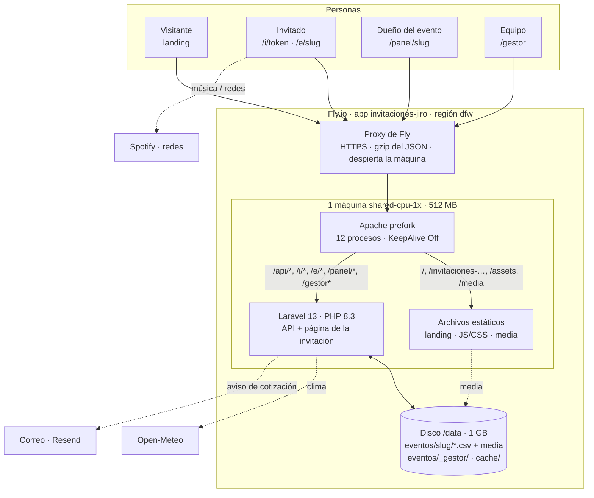

# Arquitectura del sistema

**Actualizado:** 16-oct-2026. Describe lo que está construido hoy (no un plan). Lo que cambió contra el plan original y por qué está en `../09-avance.md`; el despliegue paso a paso, en `../06-despliegue/despliegue.md`.

## En una frase

**Un solo contenedor en Fly.io** (Apache + Laravel + la web ya compilada) y **un disco persistente** donde cada evento es una carpeta de archivos CSV. No hay base de datos: los archivos *son* los datos, se abren en Excel y se respaldan copiando una carpeta.



## Las piezas

| Pieza | Qué es | Dónde vive | Quién la usa |
|---|---|---|---|
| **Landing** | Páginas HTML estáticas (inicio, boda, XV, graduación, aviso de privacidad) con el formulario para cotizar | `web/landing/` → compiladas en `public/landing/` | Clientes nuevos y buscadores |
| **Invitación** | App de Vue (SPA): la invitación general (`/e/<slug>`) y la personal de cada familia (`/i/<token>`, con su formulario) | `web/src/` → `public/app.html` + `public/assets/` | Invitados |
| **Panel del dueño** | La misma SPA en `/panel/<slug>`: generar y eliminar invitaciones, ver confirmaciones en vivo, mesas, fecha límite, dedicatorias, PDF para WhatsApp | `web/src/pages/PanelPage.vue` | El cliente (con su clave) |
| **Gestor** | La misma SPA en `/gestor`: armar y publicar invitaciones con vista previa, plantillas, biblioteca de media, personas del equipo y cotizaciones | `web/src/pages/Manager*.vue` | El equipo (cada quien con su cuenta) |
| **API** | Laravel 13 sin base de datos: lee y escribe los CSV, arma el `config` de cada invitación y valida todas las reglas | `api/` | Todo lo anterior |
| **Disco** | Volumen de Fly montado en `/data` | `/data/eventos/<slug>/`, `/data/eventos/_gestor/`, `/data/cache/` | La API (y Apache para la media) |
| **Recepción** | Buscador de invitados para la puerta: JS plano, funciona sin internet; importa `respuestas.csv` | `recepcion/` (hoy fuera de Fly) | Quien recibe en el evento |

Las tres apps (API, web y recepción) no dependen entre sí en tiempo de ejecución: la web solo habla con la API por HTTP y la recepción solo lee un CSV exportado.

## Recorrido de una petición

1. **Fly** recibe la petición por HTTPS. Si la máquina está suspendida, la despierta (unos cientos de milisegundos; si no puede reanudarla, arranca de cero en ~5 s). Comprime el JSON al salir.
2. **Apache** decide sin tocar PHP siempre que puede:
   - `/` y `/invitaciones-digitales-…` → la página estática de la landing (`RewriteRule`), con 5 min de caché.
   - `/assets/*` (JS y CSS con hash en el nombre) → archivo con caché de un año.
   - `/media/<slug>/<archivo>` → directo del disco (`AliasMatch`), con caché de 7 días, `ETag`, rangos (para el audio) y `noindex`.
3. Todo lo demás entra a **Laravel** (`public/index.php`):
   - `/api/*` → los controladores (`routes/api.php`), siempre JSON.
   - Cualquier otra ruta → `SpaController` devuelve `app.html`. En `/i/<token>`, `/e/<slug>` y `/panel/<slug>` le inyecta los datos (`window.__BOOT__`), así la invitación empieza a pintarse sin esperar otra petición.
4. **Vue** arranca, el router elige la página y carga el **tema** (sus colores, letras y adornos) y las **secciones** que dice el `config`.

## Cómo se arma una invitación

```
invitacion.csv  ─┐
ajustes.csv     ─┼─>  InvitationConfigBuilder (servidor)  ─>  config JSON  ─>  InvitationRenderer (Vue)
media/          ─┘         (Catalog: qué secciones y campos existen)               tema + sectionRegistry + sectionVariants
```

- **`invitacion.csv`** tiene todo el diseño en cuatro columnas (`seccion, elemento, campo, valor`): datos del evento, paleta, letras y cada sección en orden. Lo escribe el gestor al publicar; también se puede editar a mano o importar de Excel.
- **`ajustes.csv`** guarda lo que cambia al instante sin publicar: la clave del panel, si se ve, si es plantilla o muestra (`demo`), y la fecha límite que mueve el dueño.
- **`InvitationConfigBuilder`** (solo en el servidor; no hay otro en TypeScript) valida todo y responde los errores en español, con sección, elemento y campo.
- **El tema** (`web/src/themes/<id>/`) solo cambia la presentación: tokens de color y letra, adornos por sección (`manifest.ts`) y `theme.css`. Hay tres: `jardin-azul` (NAT), `marfil` (neutro, con dibujos de línea; el de las muestras) y `nueva-york` (oscuro: negro, perla y plata, con su horizonte animado). Agregar un tema = agregar una carpeta; un tema oscuro lleva `dark: true` en su manifiesto (el panel del dueño y la imagen para WhatsApp cambian a su versión oscura). El tema también elige **el diseño de cada sección** (variantes que cualquier tema puede usar) y las **opciones de toda la invitación** (división entre secciones, botones, confeti, títulos metálicos, esquinas); la invitación puede cambiarlas.
- **Las secciones** (`web/src/components/sections/`) solo leen tokens (`var(--color-…)`); fondos, efectos y paneles (o franjas, con secciones difuminadas) los pinta `SectionShell`. Agregar un tipo de sección = entrada en `Catalog` + componente + línea en `sectionRegistry`. Un diseño alterno de una sección = componente en `sections/variants/` + línea en `sectionVariants.ts` + opción de `variante` en `Catalog` (cada uno se descarga solo si se usa). Guías en `frontend.md` §6.
- **El gestor** edita un **borrador** (`borrador/invitacion.csv`) con autoguardado; la vista previa es la invitación real dentro de un iframe (`/gestor/vista-previa`). Los colores y textos se ven al instante (`previewPatchService`); lo demás, con el `config` que arma el servidor (~0.5 s). **Publicar** respalda la versión anterior (las últimas 50) y escribe `invitacion.csv` de forma atómica.

## Datos: todo son archivos

```
/data/eventos/
├── <slug>/
│   ├── invitacion.csv            el diseño publicado
│   ├── borrador/invitacion.csv   lo que se edita en el gestor
│   ├── ajustes.csv (+ historial) clave del panel, publicado, plantilla, demo, fecha límite
│   ├── invitaciones.csv          una fila por invitación (token, para cuántos, para quién, eliminada)
│   ├── respuestas.csv            una fila por persona (nombre, asiste, mesa) → el buscador de recepción
│   ├── respuestas-historial.csv  cada envío (solo crece)
│   ├── aperturas.csv             cada vez que se abre una invitación
│   ├── dedicatorias.csv          una por invitación
│   ├── *-eliminadas.csv          lo que se quitó al eliminar una invitación
│   ├── media/                    imágenes (WebP), SVG y audio
│   └── respaldos/                copia del día de cada CSV + versiones publicadas + bitácora
└── _gestor/
    ├── usuarios.csv              cuentas del gestor (solo el hash de la clave)
    ├── cotizaciones.csv          lo que llega de la landing
    └── papelera/                 plantillas eliminadas desde el gestor (completas, con quién)
```

Toda escritura pasa por **`CsvFile`**:

- **Candado por archivo** (`flock` sobre `.<archivo>.lock`): dos peticiones nunca escriben el mismo CSV a la vez. Las reglas que dependen del estado (cupo de lugares, "una dedicatoria por invitación", "no confirmar en una invitación eliminada") se revisan **dentro** del candado.
- **Escritura atómica**: se escribe un temporal y se renombra encima; un corte de luz nunca deja un archivo a medias.
- **Respaldo del día** antes de sobrescribir (`respaldos/<archivo>-AAAA-MM-DD.csv`).
- **UTF-8 con BOM y CRLF**, para que Excel respete los acentos; y protección contra fórmulas (un nombre que empieza con `=`, `+`, `-` o `@` se guarda con un apóstrofo).

**"En vivo" sin base de datos ni websockets:** `GET …/version` devuelve una huella (xxh128) de los CSV del evento. El panel la pide cada 5 s y solo recarga cuando cambió.

## Seguridad

| Qué | Cómo |
|---|---|
| Invitados | Cada invitación es un **token aleatorio de 12 caracteres** (~71 bits) en la URL: no se adivina y no dice de quién es. Las invitaciones llevan `noindex` y no abren sesión ni mandan cookies |
| Dueño (panel) | Su `clave_panel` → un token **cifrado con `APP_KEY`** que vence a las 12 h (`Authorization: Bearer`). Si cambia la clave, las sesiones abiertas dejan de servir |
| Equipo (gestor) | Una cuenta por persona (`usuarios.csv`, hash bcrypt), roles *administra* / *edita*; cada quien ve solo sus invitaciones. `GESTOR_CLAVE` enciende el gestor y crea la primera cuenta. Sesión cifrada de 12 h |
| Reglas de negocio | Siempre en el servidor: cupo de lugares, fecha límite, una dedicatoria por invitación, nombres fijos una vez enviados |
| Datos bancarios (mesa de regalos) | Con `solo_con_enlace` (lo normal), el servidor los quita de `/e/<slug>` y de su página precargada: solo los recibe una invitación personal (`GiftPrivacy`) |
| Abuso | Límites por IP: confirmar 10/min, dedicatoria 5/min, entrar al panel o al gestor 5/min, cotizar 5/hora (más un campo trampa y un tiempo mínimo, sin captcha) |
| Archivos | La media solo sale de `media/` (primer nivel, extensiones de imagen y audio, `nosniff`); las subidas se revisan por contenido (`finfo`) y se re-codifican (las fotos quedan sin EXIF) |
| Gestor | `X-Robots-Tag: noindex` y `frame-ancestors 'self'` (solo él puede meter su vista previa en un iframe) |
| Secretos | `APP_KEY`, `GESTOR_CLAVE` y los del correo viven en `fly secrets`, nunca en el repo |

## Cómo está montado en Fly.io

**La imagen** (`Dockerfile` de la raíz, dos etapas):

1. `node:22-alpine` compila la web con Vite: la SPA (`index.html` → `app.html`) y la landing (`landing/*.html`).
2. `php:8.3-apache` con `intl zip gd opcache exif`, Composer sin dependencias de desarrollo, la web compilada en `public/` y la configuración de `deploy/`.

**`fly.toml`:**

| Ajuste | Valor | Por qué |
|---|---|---|
| Máquina | 1 × `shared-cpu-1x`, 512 MB, región `dfw` | Suficiente para miles de visitas: casi todo lo entrega Apache sin PHP |
| Disco | Volumen `eventos` de 1 GB en `/data`, cifrado, snapshot diario | Los CSV y la media sobreviven a reinicios y a cada `fly deploy` |
| Sin visitas | `auto_stop_machines = "suspend"`, `min_machines_running = 0` | Solo se cobra mientras corre; despierta en cientos de ms |
| Concurrencia | 20 peticiones (suave) / 40 (tope) | Con 12 procesos de Apache, el proxy reparte sin ahogar la máquina |
| Salud | `GET /up` cada 30 s | Fly reinicia la máquina si deja de responder |
| Publicar | `fly deploy --ha=false` | Un solo servidor: el disco es de una máquina y los candados son locales |

**Al arrancar** (`deploy/entrypoint.sh`): crea las carpetas del disco con dueño `www-data`, le pasa `EVENTOS_PATH` a Apache y deja en caché la configuración, las rutas y las vistas de Laravel (`artisan optimize`).

**PHP** (`deploy/php.ini`): 128 MB por proceso (sube a 256 MB solo mientras convierte una foto), OPcache sin revisar archivos, subidas de hasta 60 MB (audio y zip del gestor).

**Costo:** ~2–3 USD/mes (la máquina por uso + 0.15 USD por GB de disco).

## Por qué así

- **Sin base de datos** porque los clientes y el equipo viven en Excel, los respaldos son copiar una carpeta, un evento se mueve entre local y producción con un script (`deploy/subir-evento.sh`, `bajar-evento.sh`) y el costo es mínimo.
- **Fly.io** porque da disco persistente barato y máquinas que se suspenden. Las opciones gratis (Koyeb, Render) borran el disco y Cloud Run no tiene candados de archivo.
- **Apache primero, PHP después**: la landing, los JS/CSS y la media nunca despiertan a Laravel; PHP solo atiende la API y la primera carga de cada invitación.
- **Una sola web compilada** para la invitación, el panel y el gestor: mismos componentes, la vista previa del gestor *es* la invitación real.

## Límites y cómo crecer

| Límite hoy | Qué pasa | Cuándo y cómo crecer |
|---|---|---|
| **Una sola máquina** (el disco se monta en una) | No se puede repartir la carga en varias máquinas | Subir la máquina (1–2 GB de RAM cuesta pocos dólares más). Si algún día hacen falta varias, mover los CSV a SQLite con réplica (LiteFS) o a Postgres, y la media a almacenamiento de objetos (Tigris, en Fly) |
| **1 GB de disco** | Las fotos del álbum de invitados (fase 9) son lo que más ocupa | `fly volumes extend` (0.15 USD/GB); el álbum se borra solo al cerrar su ventana |
| **512 MB de RAM** | Procesar video o fotos enormes no cabe | Las fotos se reducen en el celular antes de subir; el video se incrusta (YouTube, redes) o se sube ya listo, nunca se procesa |
| **Suspensión** | No hay tareas programadas | Lo que vence (el álbum) se limpia en la primera visita después de la fecha, o a mano con un comando |
| **Cada evento lee sus CSV completos** | Con decenas de miles de filas se notaría | Para invitaciones (cientos de familias) sobra; un evento masivo pediría una base de datos |

## Desarrollo local

`docker compose up -d --build` levanta la API (puerto 8010), la web con Vite (5173, con la landing en `/`) y la recepción (8090). La carpeta `eventos/` local hace de disco. Pruebas: `php artisan test` y `npm run test` (además `lint` y `build`). Los comandos de invitaciones (`invitacion:validar`, `exportar`, `importar`, `migrar`) y de cuentas (`gestor:usuario`) son los mismos en local y en Fly (`fly ssh console -C …`).
