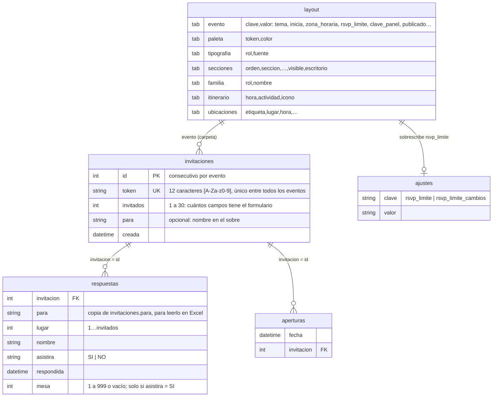

# Modelo de datos (sin base de datos)

**Actualizado:** 13-oct-2026. Reemplaza el modelo original con MySQL (tablas `events`, `invitations` y `guests`, con migraciones). Por decisión del usuario, **todo vive en archivos por evento**: así se pueden abrir en Excel y se respaldan copiando una carpeta, igual que el buscador de recepción.

El formato de cada pestaña y columna, para quien edita el Excel, está en `eventos/README.md`. Este archivo explica cómo se relacionan los archivos y qué reglas cumple el servidor.

## Archivos de un evento

```
eventos/<slug>/
├── layout.xlsx              lo edita el dueño; la API solo lo lee
├── media/                   fotos, decoraciones y audio
├── invitaciones.csv         un renglón por enlace generado en el panel
├── respuestas.csv           un renglón por persona registrada
├── respuestas-historial.csv cada envío, en orden (solo crece)
├── aperturas.csv            cada vez que se abre un enlace (solo crece)
├── dedicatorias.csv         una dedicatoria por enlace: invitacion, para, nombre, dedicatoria, fecha
├── ajustes.csv              lo que cambia el panel encima del Excel
├── ajustes-historial.csv    cada cambio de ajustes (solo crece)
├── resumen.csv              lo rehace `invitaciones:resumen`
└── respaldos/               copia del día de cada archivo antes de cambiarlo
```



**Historiales** (solo crecen):

- `respuestas-historial.csv`: `fecha, invitacion, asistira, nombres, agregados`.
- `ajustes-historial.csv`: `fecha, clave, anterior, nuevo`.

**Lugares libres:** un lugar que no está en `respuestas.csv` está libre. No hay columna de "estado": el estado de una invitación se calcula de sus renglones.

**`ajustes.csv` gana sobre el Excel:** cuando el panel cambia la fecha límite, `EventRepository` aplica el valor encima de la pestaña `evento`, así que vale en toda la app. El Excel no se toca.

## Reglas de negocio (en el servidor)

| Regla | Dónde |
|---|---|
| Nombres por envío: `1 ≤ n ≤ invitados`; nombres nuevos `≤` lugares libres → si no, `422` "Solo queda 1 lugar…" / "Tu invitación ya está completa." | `RsvpController` + `ResponseStore::add` (revisa el cupo dentro del `flock`) |
| Un nombre enviado **no cambia**: reenviarlo se ignora (sin importar mayúsculas ni espacios de más) | `ResponseStore::add` |
| `asistira` aplica a los nombres de ese envío | `ResponseStore::add` |
| Después de la fecha límite (fin del día, en la zona del evento) → `409` "Las confirmaciones cerraron el…"; solo cuentan los nombres ya enviados | `InvitationService::closedReason` |
| La fecha límite cambia **hasta 3 veces**, entre hoy y el día del evento, y distinta de la actual | `PanelService::changeDeadline` + `EventSettings` |
| Mesa: número de 1 a 999 o vacío; solo para lugares llenos con `asistira = SI`; todo o nada | `ResponseStore::assignTables` |
| Token: 12 caracteres `[A-Za-z0-9]`, único entre todos los eventos; un token mal formado responde 404 sin leer archivos | `InvitationStore` |
| Evento con `publicado = NO` → 404 en lo público | `EventController` + `InvitationService::find` |
| `clave_panel` de al menos 8 caracteres; nunca sale en el JSON público | `EventConfigBuilder` + `PanelAuth` |
| Throttle: RSVP 10/min por IP y token; login del panel 5/min por IP y evento; panel 120/min | `AppServiceProvider` + `routes/api.php` |
| Cada apertura se registra en `aperturas.csv` | `InvitationController` |
| Dedicatoria: **una por enlace** (la segunda → `409`, revisado dentro del `flock`); nombre ≤ 80 y mensaje ≤ 600; no depende de la fecha límite | `DedicationController` + `InvitationService::dedicate` + `DedicationStore::add` |
| Throttle de dedicatorias: 5/min por IP y token | `AppServiceProvider` |

## Escritura segura (`CsvFile`)

- UTF-8 con BOM y CRLF, para que Excel lo abra bien.
- `flock` sobre `.<archivo>.lock`. Leer, decidir y escribir pasa dentro del mismo candado, así que dos confirmaciones al mismo tiempo no se pisan.
- Escritura atómica: archivo temporal + `rename`.
- Antes de sobrescribir, copia del día en `respaldos/<archivo>-AAAA-MM-DD.csv`.
- Un texto que empieza con `=`, `+`, `-` o `@` se guarda neutralizado, para que Excel no lo ejecute como fórmula.
- Los archivos que escribe la API se pueden **abrir** en Excel, pero no se deben guardar desde Excel.

## Datos de prueba

- Pruebas automáticas: `api/tests/Fixtures/eventos/` (`prueba`, `borrador` sin publicar, `roto` con errores), con datos ficticios. Cada prueba los copia a una carpeta temporal.
- Pruebas a mano: `eventos/nat-prueba/`, una copia privada del evento real con su propia clave del panel.
- **Nunca** usar datos reales en lo que se versiona.
