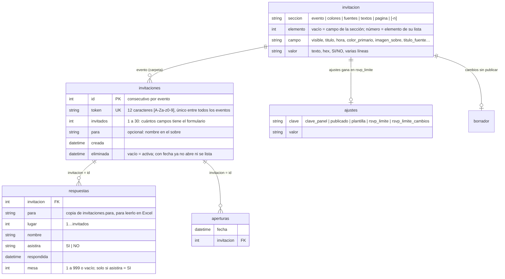

# Modelo de datos (sin base de datos)

**Actualizado:** 16-oct-2026. Reemplaza el modelo original con MySQL (tablas `events`, `invitations` y `guests`, con migraciones). Por decisión del usuario, **todo vive en archivos por evento**: así se pueden abrir en Excel y se respaldan copiando una carpeta, igual que el buscador de recepción.

El formato de `invitacion.csv` y de cada campo, para quien arma invitaciones, está en `eventos/README.md`. Este archivo explica cómo se relacionan los archivos y qué reglas cumple el servidor.

## Archivos de un evento

```
eventos/<slug>/
├── invitacion.csv           la invitación publicada (la escribe el gestor al publicar)
├── borrador/invitacion.csv  lo que se edita en el gestor (solo con cambios sin publicar)
├── layout.xlsx              formato anterior (deprecado): solo se lee si no hay invitacion.csv
├── media/                   fotos, decoraciones y audio
├── invitaciones.csv         un renglón por enlace generado en el panel
├── respuestas.csv           un renglón por persona registrada
├── respuestas-historial.csv cada envío, en orden (solo crece)
├── aperturas.csv            cada vez que se abre un enlace (solo crece)
├── dedicatorias.csv         una dedicatoria por enlace: invitacion, para, nombre, dedicatoria, fecha
├── respuestas-eliminadas.csv   personas de invitaciones eliminadas: eliminada + columnas de respuestas
├── dedicatorias-eliminadas.csv dedicatorias de invitaciones eliminadas: eliminada + columnas de dedicatorias
├── ajustes.csv              clave_panel, publicado, plantilla, demo (muestra: no guarda nada), personas_gestor y la fecha límite del cliente
├── ajustes-historial.csv    cada cambio de ajustes (solo crece)
├── resumen.csv              lo rehace `invitaciones:resumen`
└── respaldos/               copia del día de cada archivo antes de cambiarlo; las últimas 50
                             versiones publicadas (invitacion-AAAAMMDD-HHMMSS.csv) y la bitácora
                             publicaciones.csv
```

Fuera de los eventos, en la misma carpeta (y en el mismo disco en producción):

```
eventos/_gestor/
├── usuarios.csv   las personas del gestor: usuario, nombre, rol (admin|editor), activo (SI|NO),
│                  clave (solo el hash bcrypt), cambiar_clave (SI = tiene clave temporal),
│                  creado, ultimo_acceso
├── cotizaciones.csv  lo que llega de la landing
├── visitas/       una página vista por renglón, un archivo por día (AAAA-MM-DD.csv): fecha,
│                  pagina, tipo (landing|invitacion|personal|muestra), evento, origen,
│                  referencia, campana, dispositivo, sistema, navegador, ip, visitante
│                  (código de IP + navegador, sin guardar el navegador), equipo (SI = alguien
│                  del gestor). La IP se borra a los 365 días (ip-borradas-hasta.txt dice
│                  hasta qué día); el renglón se queda
├── papelera/      lo eliminado desde el gestor: <slug>-AAAAMMDD-HHMMSS/ (la carpeta completa)
│                  y papelera.csv (fecha, evento, tipo, carpeta, enlaces, confirmados,
│                  usuario, nombre)
└── respaldos/     copia del día de usuarios.csv antes de cambiarlo
```

`_gestor` nunca puede ser la dirección de un evento (las direcciones empiezan con minúscula o número), así que no aparece en la lista ni en lo público.

**`invitacion.csv`** tiene cuatro columnas: `seccion, elemento, campo, valor`. Los bloques `evento`, `colores`, `fuentes`, `textos` y `pagina` son datos; cualquier otro valor de `seccion` es una sección, en el orden en que aparece. Un número en `elemento` es un elemento de la lista de esa sección. El servidor la convierte en el `config` de la invitación con `InvitationConfigBuilder`; lo que no reconoce lo conserva y lo avisa.



**Historiales** (solo crecen):

- `respuestas-historial.csv`: `fecha, invitacion, asistira, nombres, agregados`.
- `ajustes-historial.csv`: `fecha, clave, anterior, nuevo, usuario, nombre` (quién: una persona del gestor, `panel` si fue el dueño, `terminal` si fue un comando).
- `respaldos/publicaciones.csv`: `fecha, origen, secciones, usuario, nombre`; un renglón por publicación, por invitación creada o copiada (`nueva`, `copia de <slug>`) y por migración (`formato anterior`). Con él, el historial dice quién publicó cada versión.
- Si una bitácora gana una columna, el primer renglón nuevo la reescribe con ella y los renglones de antes la dejan vacía (`CsvFile::append`).

**Lugares libres:** un lugar que no está en `respuestas.csv` está libre. No hay columna de "estado": el estado de una invitación se calcula de sus renglones.

**`ajustes.csv` gana sobre la invitación:** `EventRepository::eventValue()` lee primero los ajustes (`clave_panel`, `publicado`, `plantilla`, `rsvp_limite`) y después el diseño, así que valen en toda la app sin publicar nada. La invitación no se toca. En el formato anterior pasa lo mismo encima de la pestaña `evento`.

## Reglas de negocio (en el servidor)

| Regla | Dónde |
|---|---|
| Nombres por envío: `1 ≤ n ≤ invitados`; nombres nuevos `≤` lugares libres → si no, `422` "Solo queda 1 lugar…" / "Tu invitación ya está completa." | `RsvpController` + `ResponseStore::add` (revisa el cupo dentro del `flock`) |
| Un nombre enviado **no cambia**: reenviarlo se ignora (sin importar mayúsculas ni espacios de más) | `ResponseStore::add` |
| `asistira` aplica a los nombres de ese envío | `ResponseStore::add` |
| Después de la fecha límite (fin del día, en la zona del evento) → `409` "Las confirmaciones cerraron el…"; solo cuentan los nombres ya enviados | `InvitationService::closedReason` |
| La fecha límite cambia **hasta 3 veces**, entre hoy y el día del evento, y distinta de la actual | `PanelService::changeDeadline` + `EventSettings` |
| Mesa: número de 1 a 999 o vacío; solo para lugares llenos con `asistira = SI`; todo o nada | `ResponseStore::assignTables` |
| Token: 12 caracteres `[A-Za-z0-9]`, único entre todos los eventos; un token mal formado responde 404 sin leer archivos | `InvitationStore` |
| Evento con `publicado = NO` → 404 en lo público | `EventController` + `InvitationService::find` |
| `clave_panel` de al menos 8 caracteres; nunca sale en el JSON público | `EventConfigBuilder` + `PanelAuth` |
| Throttle: RSVP 10/min por IP y token; login del panel 5/min por IP y evento; panel 120/min | `AppServiceProvider` + `routes/api.php` |
| Cada apertura se registra en `aperturas.csv` | `InvitationController` |
| Dedicatoria: **una por enlace** (la segunda → `409`, revisado dentro del `flock`); nombre ≤ 80 y mensaje ≤ 600; no depende de la fecha límite | `DedicationController` + `InvitationService::dedicate` + `DedicationStore::add` |
| Throttle de dedicatorias: 5/min por IP y token | `AppServiceProvider` |
| Gestor: sin `GESTOR_CLAVE` de 16+ caracteres → `403`; cada persona con su usuario y su clave (10+ caracteres, hash bcrypt); la clave maestra solo crea la primera cuenta; login 5/min por IP; el resto 240/min | `ManagerAuth` + `EnsureManagerSession` + `routes/api.php` |
| Quién ve qué: quien edita solo ve las invitaciones que creó o le asignaron (`ajustes.csv` → `personas_gestor`: "ana, beto") y todas las plantillas; quien administra ve todas y es quien asigna. En otra invitación todo responde `403` | `ManagerAccess` + `EnsureManagerEventAccess` + `ManagerEvents::list` |
| Cuentas: solo quien administra agrega, cambia o quita el acceso; nadie se quita el acceso ni el rol a sí mismo y siempre queda alguien activo que administra; nadie se borra (el historial guarda su nombre); una clave temporal se cambia al entrar | `ManagerUsers` + `UserController` + `EnsureManagerAdmin` |
| Borrador: se guarda solo si la versión que manda el editor es la actual (bajo candado); si no, `409` con la versión y el diseño de la otra ventana | `DesignStore::saveDraft` |
| Publicar: en modo estricto (con errores → `422 { issues }`); respalda lo publicado, escribe atómico, borra el borrador y anota la bitácora | `DesignPublisher` |
| Fecha límite al publicar: si el cliente ya la movió, la suya gana, salvo que el gestor elija reemplazarla (se borra solo su fecha; los cambios usados y el historial quedan) | `DesignPublisher` |
| Diseño: máximo 60 secciones, 120 campos por sección, 100 elementos y 4000 caracteres por valor; los enlaces deben empezar con `https://` | `Catalog::LIMITS` + `InvitationConfigBuilder` |
| Opciones de diseño (`orilla` de la página o de una sección, `botones`, `esquinas`): solo valores del catálogo; uno que no existe se avisa en `issues` y se ignora (queda lo del tema). El `variante` de una sección pasa tal cual: si la web no tiene ese diseño, pinta el de siempre | `Catalog::EDGES`, `BUTTONS`, `CORNERS` + `InvitationConfigBuilder::choice` |
| Mesa de regalos: con `solo_con_enlace` (SI si no se escribe), `banco`, `cuenta` y `titular` solo viajan a `/i/<token>`; `/e/<slug>` (la API y la página precargada) los recibe vacíos con `hidden: true`. Las tiendas y su número de evento se ven en las dos. Sin tiendas ni lluvia de sobres, la sección no sale (en la web: `hasGifts`) | `GiftPrivacy` + `EventController` + `SpaController` |
| La clave del panel nunca va en el diseño: no se exporta, no se copia al duplicar ni al hacer plantilla, y el historial de ajustes dice "(cambiada)" | `EventSettings` + `DesignFactory` + `DesignTransfer` |
| Nueva invitación o copia: solo el diseño y `media/` (sin `originales/`); nunca enlaces, respuestas, `respaldos/` ni `borrador/`; nace con `publicado=NO` y clave nueva | `DesignFactory` |
| Plantilla (`plantilla=SI`): `404` en todo lo público y sin panel | `EventRepository` |
| Eliminar desde el gestor: solo quien administra. La carpeta no se borra: pasa entera a `_gestor/papelera/` (con fecha en el nombre) y queda anotado quién y qué tenía. Una invitación (o muestra) visible, con enlaces o con respuestas solo se elimina escribiendo su dirección (`confirm`); después, sus enlaces, su panel y su media dan `404` | `EventTrash` + `Manager\EventController::destroy` |
| Eliminar una invitación (panel): se marca `eliminada` en `invitaciones.csv` (el número nunca se reutiliza, así sus aperturas e historial no pasan a otra) y el enlace da `404`; sus personas y su dedicatoria pasan a `*-eliminadas.csv`. Un envío que llega justo después ya no escribe nada (`404`): `ResponseStore::add` y `DedicationStore::add` revisan dentro de su candado que la invitación siga activa | `PanelService::deleteInvitation` + `InvitationStore::delete` |
| Media: jpg, png, webp o gif (≤ 15 MB, revisado con `finfo`; nunca SVG ni HTML) → WebP; mp3 o m4a (≤ 20 MB); no se borra lo que la invitación usa (publicada o borrador) | `MediaLibrary` + `ImageOptimizer` |

## Escritura segura (`CsvFile`)

- UTF-8 con BOM y CRLF, para que Excel lo abra bien.
- `flock` sobre `.<archivo>.lock`. Leer, decidir y escribir pasa dentro del mismo candado, así que dos confirmaciones al mismo tiempo no se pisan.
- Escritura atómica: archivo temporal + `rename`.
- Antes de sobrescribir, copia del día en `respaldos/<archivo>-AAAA-MM-DD.csv`.
- Un texto que empieza con `=`, `+`, `-` o `@` se guarda neutralizado, para que Excel no lo ejecute como fórmula.
- Los archivos que escribe la API se pueden **abrir** en Excel, pero no se deben guardar desde Excel.

## Datos de prueba

- Pruebas automáticas: `api/tests/Fixtures/eventos/` (`prueba`, `borrador` sin publicar, `roto` con errores, en el formato anterior; `nueva`, en `invitacion.csv`), con datos ficticios. Cada prueba los copia a una carpeta temporal. `LegacyEquivalenceTest` comprueba que el formato anterior y el nuevo dan la misma invitación.
- Pruebas a mano: `eventos/nat-prueba/`, una copia privada del evento real con su propia clave del panel.
- **Nunca** usar datos reales en lo que se versiona.
