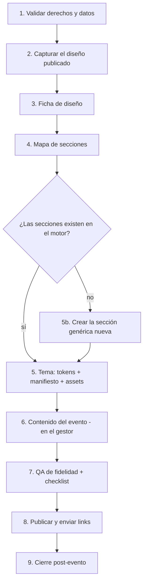

# Playbook: de un diseño de Canva a un tema de código

Proceso repetible para convertir cualquier invitación hecha en Canva (o en otra herramienta) en un **tema** del motor de invitaciones. Tiempo típico, una vez que el motor existe: **1–2 días por tema nuevo** y **15 minutos por evento** que reutiliza un tema.

## 1. Validar derechos y datos (5 min)

- [ ] ¿El diseño es tuyo o del cliente que te contrata? Si es de un tercero, **pide permiso** o crea un diseño propio inspirado en él (sin copiar sus ilustraciones).
- [ ] ¿Contiene fotos o datos de menores? Si sí, se tratan como **privados**: fuera de git, `noindex` y borrado al terminar.
- [ ] ¿La música tiene derechos? Usa archivos del cliente o enlaces de Spotify/YouTube.

## 2. Capturar el diseño publicado (15 min)

1. Abrir el sitio publicado (`*.my.canva.site/...`) en Chrome.
2. DevTools → Console → pegar `scripts/extraer-diseno-canva.js`. Descarga `diseno-<slug>.json`.
3. **Capturas:** hacer scroll del contenedor (`__sc.scrollTo(0, N)`) cada `innerHeight` px y tomar una captura de cada tramo.
   - Hacerlo con dos tamaños de ventana: escritorio (≈1054 px) y móvil (DevTools → 390×844).
   - Nombrar `01.jpg`, `02.jpg`…, **pixelar las fotos de personas** y guardarlas en `privado/capturas/` (fuera de git), porque suelen mostrar nombres y fechas reales.
4. Anotar la URL, la fecha de captura y si hay embeds (countdown, mapas, música).

## 3. Ficha de diseño (30 min) → `plantilla-ficha-diseno.md`

- **Paleta:** colores de texto del JSON (`textColors`) más los de fondo muestreados en las capturas.
- **Fuentes:** Canva ofusca los nombres (`YAxxxx_0`). Identificarlas visualmente y elegir equivalentes en Google Fonts.
- **Escala tipográfica:** usar `fontSize` y `letterSpacing` del JSON, agrupados por rol.
- **Texturas, materiales y efectos** del original (casi siempre estático en Canva).

## 4. Mapa de secciones (30 min)

- Agrupar textos e imágenes del JSON por rangos de `y` → una sección por bloque visual.
- Asignar a cada sección:
  - un **componente del motor** (`HeroEnvelope`, `Itinerary`…);
  - qué es **dato del evento** y qué es **decoración del tema**;
  - qué **efecto** se aplica (ver `01-analisis-codigo/efectos-reutilizables.md`).
- Marcar lo que en Canva es imagen y en código debe **generarse**: calendario, countdown, líneas, botones, iconos.

## 5. Tema (0.5–1 día)

1. **Exportar los assets desde el editor de Canva**, no desde el sitio publicado: PNG transparente → WebP optimizado a 2×.
2. **Crear el tema** en `src/themes/<id>/`:
   - `theme.css` con los tokens.
   - `manifest.ts` con fuentes, variantes, decoraciones e iconos.
3. **Un diseño propio para cada sección**, aunque el contenido sea el mismo: el tema nuevo no es otro recoloreado (D20).
   - Para cada sección, primero una idea del tema (Nueva York: elevador, boleto de Broadway, metro, Grand Central…).
   - Después, usar un diseño que ya exista (`components/sections/variants/`, catálogo en `01-analisis-codigo/efectos-reutilizables.md`) o crear uno nuevo (`03-arquitectura-objetivo/frontend.md` §6). Todo diseño nuevo sirve después en cualquier tema.
   - Los dibujos genéricos van en `themes/_shared/assets/`; los íconos nuevos, en `assets/icons/`.
4. **Opciones de toda la invitación** en el manifiesto: la división entre secciones (`edges`; con la plantilla difuminada, `pagina,,difuminar,SI`), `buttons`, `confetti`, `metallic` y `corners`. Si el diseño pide un detalle que no existe (otra orilla, otro botón), se agrega como opción, no fijo en el tema.
5. Nunca meter datos del evento en el tema.

## 6. Contenido del evento (15 min)

- En el **gestor** (`/gestor`): *Nueva invitación* desde la plantilla del tema (o en blanco), y llenar cada sección con la invitación a la vista. El formato es `invitacion.csv` (`eventos/README.md`).
- **La plantilla del tema:** guárdala en `deploy/plantillas/<id>/invitacion.csv` (solo diseño, sin datos de personas). Se instala con `deploy/plantillas/instalar.sh <id>` en local y con `subir.sh <id>` en Fly.
- ~~**Familias:** importar el CSV `family_name,passes,phone`.~~ **Cambió:** los enlaces se generan en el panel por número de invitados.

## 7. QA (1 h)

- Comparación visual lado a lado con las capturas (390 px y 1054 px).
- Que no se parezca a otro tema y que los otros no cambien: capturas de NAT y de las muestras antes y después.
- `05-calidad/checklist-qa.md` completo.

## 8. Publicar y enviar (30 min)

- **Publicar** en el gestor; en *Datos generales*, *Visible* y la clave del cliente.
- **Enviar los enlaces:** en el panel del cliente (`/panel/<slug>`), "Enviar" arma el PDF o la imagen con el QR para WhatsApp.
- **Monitorear:** revisar las respuestas en el panel durante la semana del deadline.

## 9. Cierre post-evento

- Exportar las respuestas y archivar el evento.
- Borrar las fotos de menores si el cliente lo pide.
- Guardar el tema como **plantilla reutilizable** (con un evento demo de datos ficticios).

---

### Lecciones aprendidas (Canva)

- **Diseños para celular:** Canva publica los sitios "móviles" como una columna de ≈460 px. Conviene diseñar el tema *mobile-first* con `max-width: 480px`.
- **Elementos que vienen como imagen:**
  - El reproductor de música, el calendario y los botones suelen ser imágenes. En código se reconstruyen como componentes funcionales.
  - Algunos elementos se sirven como `blob:` (formas o SVG renderizados), así que no hay URL para descargarlos. Se exportan desde el editor o se recrean en SVG/CSS.
- **Embeds externos:**
  - Los countdowns embebidos pueden quedar mal configurados (en NAT apuntaba a otra fecha). En código se calculan desde la fecha del evento.
  - Las playlists de Spotify no cargan en la app Embed de Canva (las canciones sueltas sí). En código, el iframe directo de Spotify funciona sin problema.
